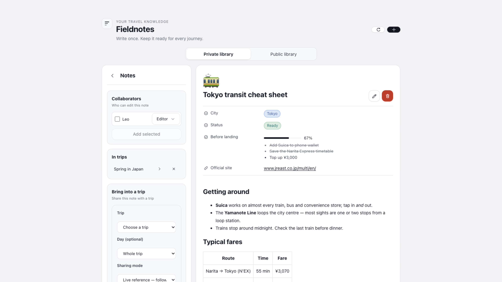
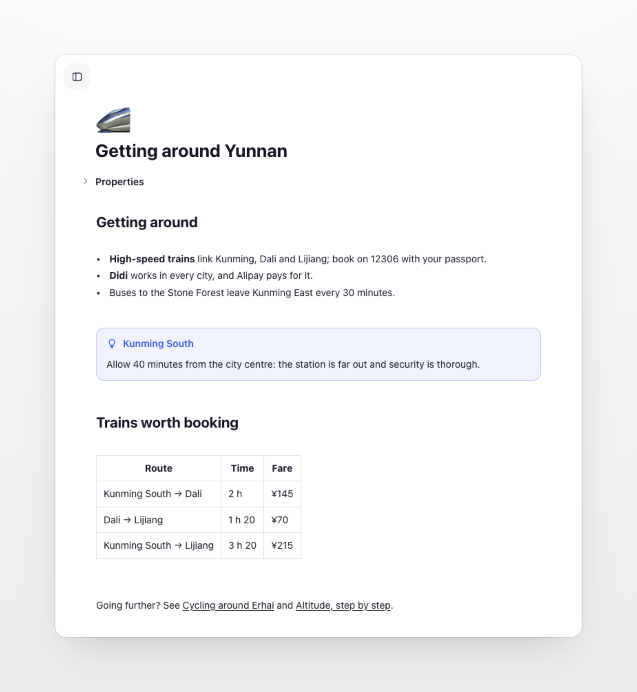
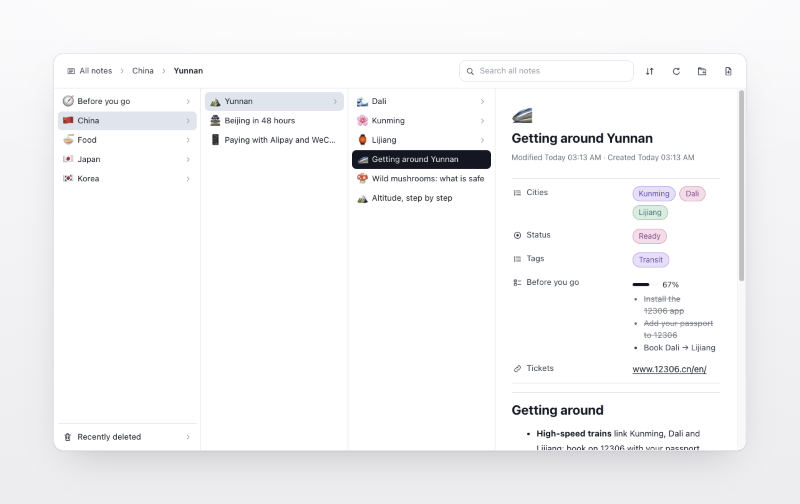
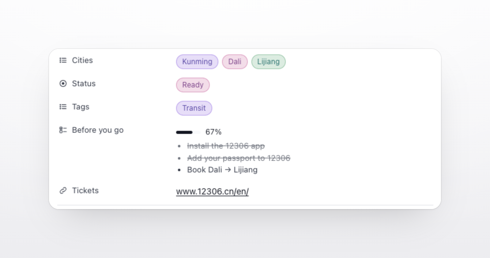
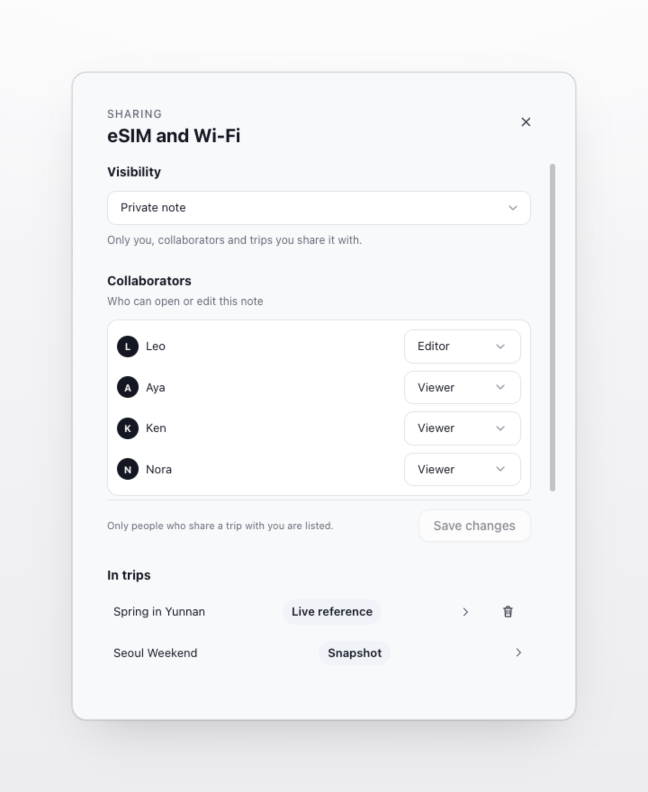
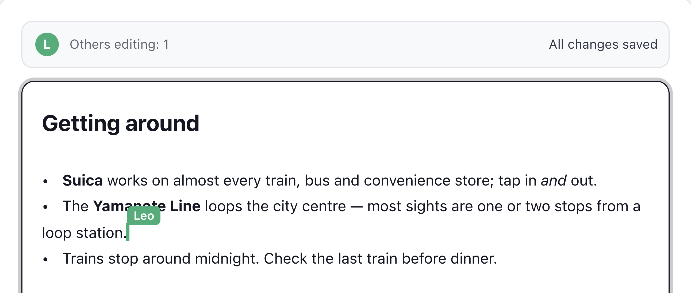
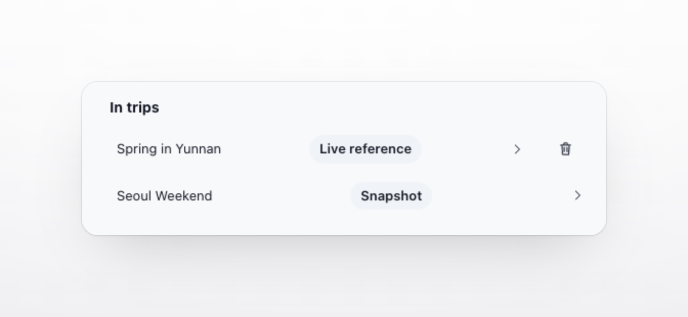
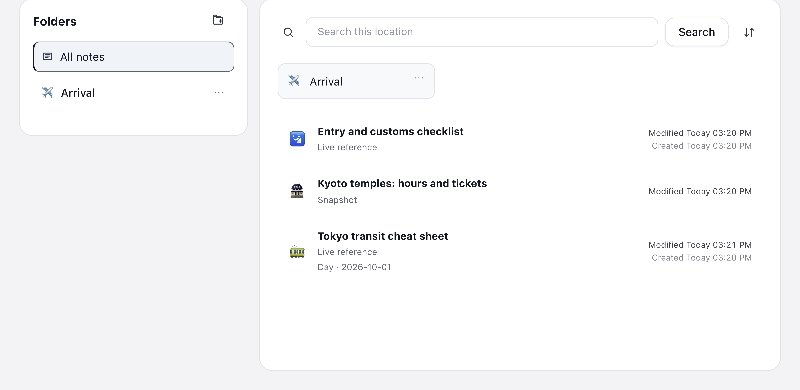

# Fieldnotes

**English** | [简体中文](README.zh-CN.md)

Write it down once. Have it on every trip.  
Fieldnotes is a private travel notebook inside [TREK](https://github.com/mauriceboe/TREK), the self-hosted trip planner: how to get around a city, how to behave at temples and shrines in another country, which apps are worth installing and how to use them. Keep it all in your own library, and bring the right notes into each trip when you need them.

Fieldnotes works on its own as your library. To read shared notes inside a trip, add its companion [Trip Fieldnotes](https://github.com/Tangerineeew/fieldnotes-trip), which gives every trip a notes tab where your travel companions can read what you share.

## Screenshots



## What it does

Fieldnotes has five parts: writing, organising, sharing, co-editing, and bringing notes into trips. Each is described below.

### Writing

The editor is built on Markdown and follows the conventions of common Markdown editors: what you write is always plain text, and what you see is the formatted result.

<table>
<tr>
<td width="50%" valign="top">
<p><b>Live rendering</b><br>Headings, lists, tables, quotes and links are shown formatted as you type. Markdown symbols appear only where the cursor is, so they are there when you edit and out of the way when you read.</p>
<p><b>Slash menu</b><br>Type <code>/</code> on an empty line to insert a heading, to-do list, bulleted list, quote, divider or image. Each entry shows the Markdown it stands for, so you can type it directly once you know it.</p>
<p><b>Keyboard shortcuts</b><br><kbd>⌘B</kbd> bold, <kbd>⌘I</kbd> italic, <kbd>⌘E</kbd> inline code, <kbd>⌘⇧X</kbd> strikethrough, <kbd>⌘K</kbd> link, <kbd>⌘1</kbd>–<kbd>⌘6</kbd> heading levels, and <kbd>⌘0</kbd> back to plain text. Use <kbd>Ctrl</kbd> on Windows and Linux.</p>
</td>
<td width="50%" valign="top"></td>
</tr>
</table>

<table>
<tr>
<td width="33%" valign="top"><p><b>🖼️ Images saved with the note</b><br>Paste a photo or drop it into a note. It is compressed in the browser (longest side at most 2560 pixels; GIFs are kept as they are, so they still move) and saved with the note on your TREK server, so it still shows if the original website goes away.</p></td>
<td width="33%" valign="top"><p><b>🔗 Links between notes</b><br><code>[[Note title]]</code> links to another note, which opens with a click. When two notes share a title, use <code>[[Folder/Note title]]</code>. A link that matches no note stays as plain text.</p></td>
<td width="33%" valign="top"><p><b>💾 Automatic saving</b><br>Edits to an existing note are saved automatically, and the bar at the top says "All changes saved". <kbd>⌘Z</kbd> and <kbd>⌘⇧Z</kbd> undo and redo only your own changes, never those of people editing with you.</p></td>
</tr>
</table>

### Organising

<table>
<tr>
<td width="50%" valign="top"></td>
<td width="50%" valign="top">
<p><b>Folders</b><br>Organise notes in folders and sub-folders, as deep as you need. Drag a note onto a folder to move it; folders can be dragged into other folders too. A folder can only be deleted once it is empty, so no note is lost by accident.</p>
<p><b>Icons</b><br>A folder can have an emoji or an icon of up to 8 characters. A note can have an emoji or an uploaded image, which is cropped to a centred square.</p>
<p><b>Two libraries</b><br>The private library shows your own notes and the notes others share with you, marked "Shared with me". The public library shows every note made public on your TREK.</p>
</td>
</tr>
</table>

<table>
<tr>
<td width="50%" valign="top">
<p><b>Properties</b><br>As in Notion, each note can have up to 30 properties of nine kinds:</p>
<ul>
<li>Text, number, date, URL and checkbox</li>
<li>Select and multi-select, shown as coloured labels, for things like a city or a status</li>
<li>Checklist, with up to 50 items and its progress worked out for you</li>
<li>Last edited, which updates by itself</li>
</ul>
<p>URL properties open in a new tab, and property values are included in search.</p>
</td>
<td width="50%" valign="top"></td>
</tr>
</table>

<table>
<tr>
<td width="50%" valign="top"><p><b>🔍 Search</b><br>Search covers wherever you are: all notes from "All notes", or just one folder once you open it. Titles, text and property values are searched, and symbols such as <code>%</code> and <code>_</code> are matched literally.</p></td>
<td width="50%" valign="top"><p><b>↕️ Sorting</b><br>Sort by name, creation date or last change, ascending or descending. Names compare numbers by value, so "Day 2" comes before "Day 10". Your chosen order is remembered for next time.</p></td>
</tr>
</table>

### Sharing

<table>
<tr>
<td width="50%" valign="top"></td>
<td width="50%" valign="top">
<p><b>Editors and viewers</b><br>You can invite people who share a trip with you to a single note or to a whole folder. Editors can change the content with you; viewers can read it.</p>
<p><b>Folder access carries down</b><br>Access given to a folder applies to every note and sub-folder inside it, which makes it easy to share everything about a country or a whole trip at once.</p>
<p><b>Saved together</b><br>Role changes and new people take effect when you save them, and closing the dialog with unsaved changes asks for confirmation first.</p>
</td>
</tr>
</table>

<table>
<tr>
<td width="33%" valign="top"><p><b>🔒 Private by default</b><br>A new note is visible only to you until you invite someone, make it public, or bring it into a trip.</p></td>
<td width="33%" valign="top"><p><b>🌐 Public notes</b><br>A note can be made public, so everyone signed in to your TREK can read it in the public library. If any folder above it is private, the note stays private.</p></td>
<td width="33%" valign="top"><p><b>👤 What only the owner decides</b><br>Editors can change the content. Who can see the note, which folder it is in, and whether it can be shared live with a trip are decided by the owner.</p></td>
</tr>
</table>

### Co-editing

<table>
<tr>
<td width="50%" valign="top">
<p><b>One shared document</b><br>When several people open the same note, they edit one shared document. Each person has a colour, you see the others' cursors and names, and the bar at the top shows how many others are editing.</p>
<p><b>Changes merge</b><br>Everyone's changes are merged automatically, so nobody has to wait for anyone else and there is no "this note was changed by someone else" conflict. Titles, properties and icons can be edited together as well.</p>
<p><b>Connection drops</b><br>If the connection drops briefly, edits are kept locally and synced when it returns. If an editing session stops for any reason, the editor says why, and "Rejoin" continues from the latest version.</p>
</td>
<td width="50%" valign="top"></td>
</tr>
</table>

### Bringing notes into a trip

A note can be brought into any number of trips, each time as a live reference or as a snapshot.

| | Live reference | Snapshot |
|---|---|---|
| What the trip shows | The note's current version | The version from when it was added |
| Your later edits | Appear in the trip | Do not change the snapshot |
| Images | Shown from the original note | Copied into the snapshot |
| After you delete the original | No longer shown | Kept |
| After you leave the trip | Private notes no longer shown | Kept |
| Good for | Guides and checklists you keep updating | Information that should stay exactly as it was, such as details you confirmed before leaving |

<table>
<tr>
<td width="40%" valign="top"></td>
<td width="60%" valign="top">
<p><b>How to add a note</b><br>Open a note and, under "Bring into a trip" in the sidebar, choose the trip, an optional day and the sharing mode. A private note someone else shared with you can only be added as a snapshot; sharing it live is the owner's decision.</p>
<p><b>In trips</b><br>The owner sees in the sidebar which trips a note has been added to, and can jump straight to that trip's tab or remove the note from it.</p>
<p><b>Linked to a day</b><br>When adding a note, you can pick a day of the trip; the note then shows that day in the trip.</p>
<p><b>Copied into the day plan</b><br>While reading a note in a trip, you can copy an excerpt of up to 500 characters into a day's plan, where it becomes an ordinary day note. The original note is not changed.</p>
</td>
</tr>
</table>



### AI assistants

An AI assistant connected to TREK can use the `list_trip_notes` tool to read the notes shared with a trip you can access, and answer questions such as "How do we pay for trains in Tokyo on this trip?". It reads with your permissions, cannot see trips you have no access to, and cannot change anything.

### Other details

<table>
<tr>
<td width="33%" valign="top"><p><b>🌍 Languages</b><br>The interface and error messages follow TREK's language setting: English, Simplified Chinese, Traditional Chinese, German, Spanish, French, Hungarian, Dutch, Brazilian Portuguese, Czech, Polish, Russian, Italian and Arabic, with a right-to-left layout for Arabic.</p></td>
<td width="33%" valign="top"><p><b>📝 Unsaved changes</b><br>While a note has unsaved changes, Fieldnotes asks before you turn a page, open another note, switch folders or go back to the library.</p></td>
<td width="33%" valign="top"><p><b>⚠️ Error messages</b><br>When something fails, the reason is shown, such as "A folder with this name already exists here" or "This note changed. Reload before saving.", rather than a status code.</p></td>
</tr>
<tr>
<td width="33%" valign="top"><p><b>🗄️ Where data lives</b><br>Notes, folders and images are stored on your own TREK server, in Fieldnotes' own database, never with a third-party service.</p></td>
<td width="33%" valign="top"><p><b>🌐 Images from other websites</b><br>Images linked from other websites are fetched by your TREK server, so readers' browsers never contact those sites. Until an administrator allows a site, its images show why they cannot load.</p></td>
<td width="33%" valign="top"><p><b>📦 Images in snapshots</b><br>Taking a snapshot copies its images. An image from another website that cannot be fetched at that moment is skipped rather than blocking the snapshot.</p></td>
</tr>
</table>

## Permissions

Fieldnotes keeps your notes, folders and images to itself and only asks TREK for what the features above need. It always acts as you, so it can never see a trip you are not part of or change one you are not allowed to edit.

| Permission | What it is used for |
|---|---|
| `db:own` | Saving your notes, folders, sharing choices, trip links, snapshots and pasted images. |
| `db:read:trips` | Showing your trips and their days when you add a note to a trip, and suggesting people to share with: the members of trips you are on. |
| `db:read:files` | Finding images that come from files attached to a trip. |
| `db:read:files:content` | Displaying those images and keeping a copy of them in snapshots. |
| `db:meta` | Checking that you are allowed to edit a trip before you add, remove or arrange its notes. |
| `db:write:daynotes` | Copying an excerpt you choose into a day of the trip plan. |
| `db:read:users` | Showing who else is editing a note with you. |
| `hook:user-data` | Including your notes when you export your TREK data, and deleting them when your account is deleted. |
| `mcp:tools` | Letting an AI assistant connected to TREK read the notes shared with a trip you can access. TREK shows this as "Publishes AI tools". |
| `http:outbound` | Showing images that a note links from another website. This stays switched off until an administrator allows that website, and private network addresses are always blocked. |

## Setup

1. As an administrator, open **Admin → Plugins** in TREK. Find **Fieldnotes** and **Trip Fieldnotes** under **Discover** and install them, or download their ZIP files from the Releases page of each repository and install them with **Upload plugin**.
2. Turn on **Fieldnotes** first and **Trip Fieldnotes** second. New plugins start switched off.
3. Open **Fieldnotes** from the navigation bar and write your first note. To share it with a trip, use **Bring into a trip** next to the note.

> [!WARNING]
> Uninstalling Fieldnotes deletes every note, folder and image it stores. Back up TREK before you uninstall it. Updating to a newer release keeps everything.

Optional: notes can show images linked from other websites once you allow those websites in **Admin → Plugins → ⋯ → Allowed hosts** on Fieldnotes, for example `*.example.com`. Copying an image and pasting it into the note always works without any setup.

## Good to know

- **Who can read my notes?** Only you, until you invite someone, make the note public, or add it to a trip. A live reference is visible to everyone on that trip.
- **What happens if I leave a trip?** Your private notes that the trip followed as live references are no longer shown there. Snapshots stay, because the trip received them as copies.
- **Where are my notes kept, and can I take them with me?** In Fieldnotes' own database on your TREK server, never with a third-party service. They are included when you export your account data from TREK. There is no export to Markdown files yet, but every note is plain Markdown that you can copy straight out of the editor.
- **How big can images be?** Up to 4 MB each, after automatic compression.

## For developers

The ready-to-install plugin sits at the top of this repository. Its source code and tests are in [`source/`](./source), which also builds Trip Fieldnotes; that is where changes are made.

```bash
cd source
npm ci
npm test         # server, client and translation tests
npm run export   # rebuilds the plugin files here and in the sibling fieldnotes-trip checkout
```

## License

[MIT](./LICENSE)
