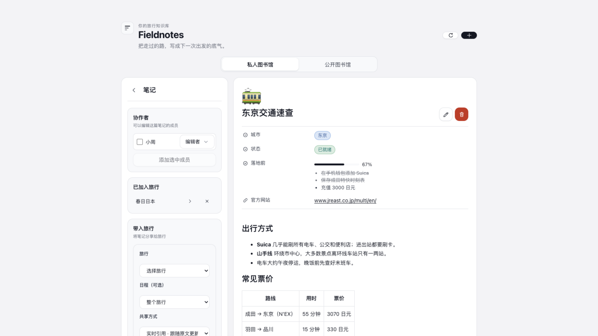
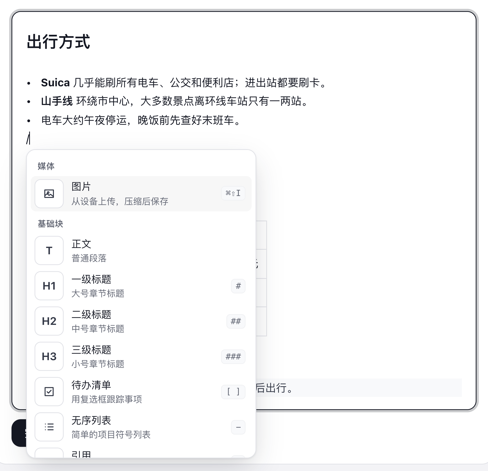
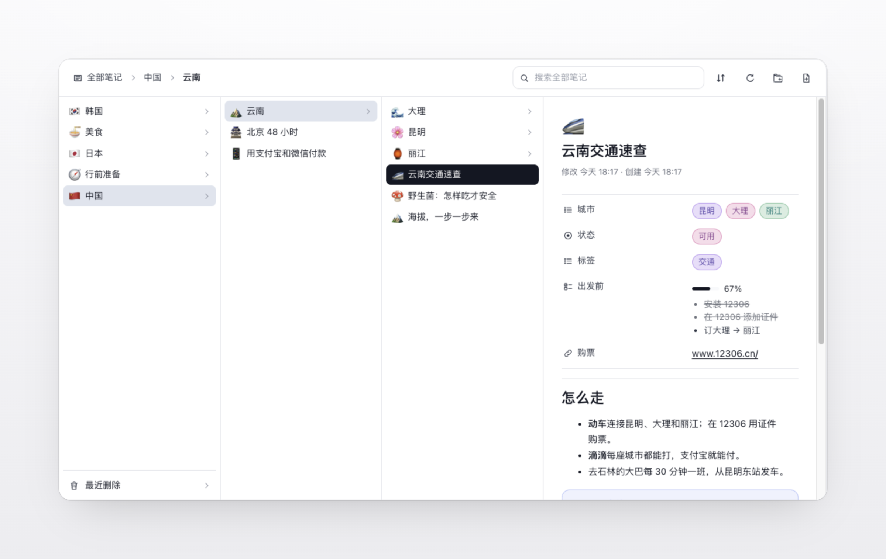
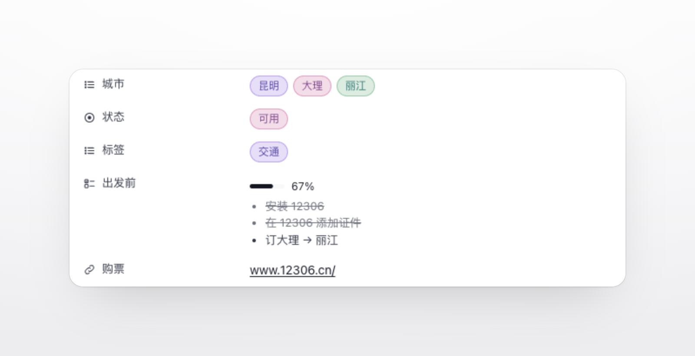
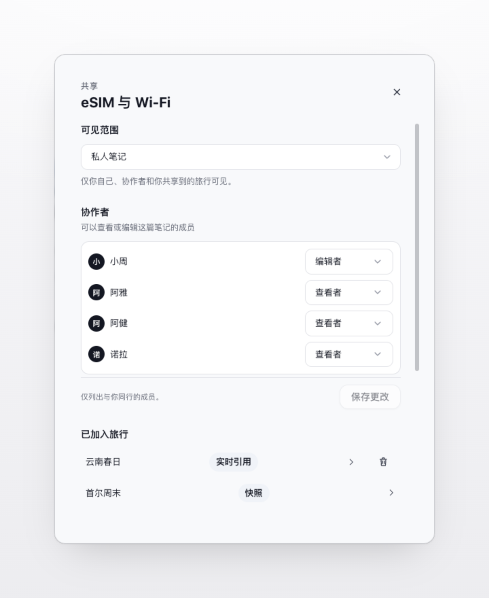
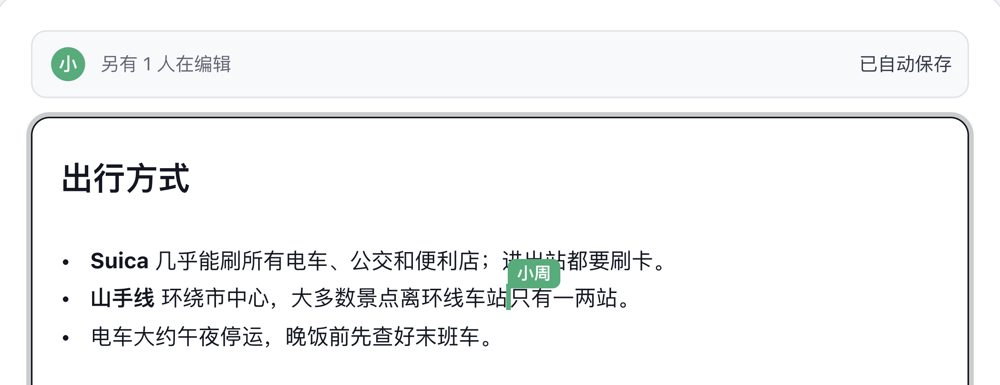
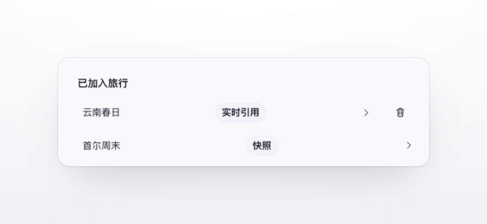
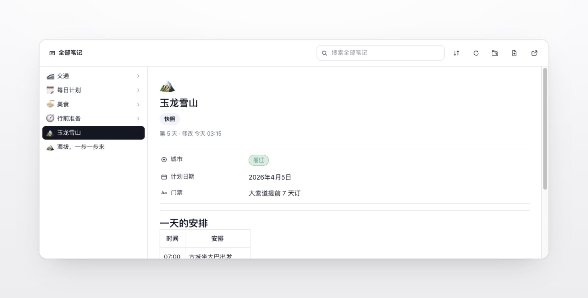

# Fieldnotes

[English](README.md) | **简体中文**

记录下旅途中积累的经验，下次出发随时用得上。  
Fieldnotes 是自托管旅行规划工具 [TREK](https://github.com/mauriceboe/TREK) 里的一本私人旅行笔记：怎样在一座城市里出行？不同国家宗教场所的礼仪？APP的使用方法和技巧？都可以记在这里。  
先收进自己的图书馆，需要时再把合适的笔记带进每一次旅行。

Fieldnotes 单独安装就能作为你的图书馆使用。想在旅行里阅读分享的笔记，再加上配套插件 [Trip Fieldnotes](https://github.com/Tangerineeew/fieldnotes-trip)：它会在每次旅行中添加一个笔记标签页，同行的伙伴都能在那里阅读你分享的内容。

## 截图



## 功能介绍

Fieldnotes 由五部分组成：写作、整理、分享、协同编辑，以及把笔记带进旅行。下面逐一介绍。

### 写作

编辑器以 Markdown 为基础，参考了常见 Markdown 编辑器的做法：你写下的始终是纯文本，屏幕上看到的则是排版后的效果。

<table>
<tr>
<td width="50%" valign="top">
<p><b>即时渲染</b><br>标题、列表、表格、引用和链接在输入时就显示为排版后的样子。Markdown 符号只在光标所在的那一处显示出来，方便修改；光标移开后，正文里只留下排版后的内容。</p>
<p><b>斜杠菜单</b><br>在空行输入 <code>/</code>，可以插入标题、待办清单、无序列表、引用、分隔线或图片。每一项旁边都标出了对应的 Markdown 写法，熟悉之后也可以直接输入。</p>
<p><b>快捷键</b><br><kbd>⌘B</kbd> 加粗、<kbd>⌘I</kbd> 斜体、<kbd>⌘E</kbd> 行内代码、<kbd>⌘⇧X</kbd> 删除线、<kbd>⌘K</kbd> 插入链接，<kbd>⌘1</kbd>–<kbd>⌘6</kbd> 设置标题级别，<kbd>⌘0</kbd> 恢复为正文。Windows 和 Linux 上使用 <kbd>Ctrl</kbd>。</p>
</td>
<td width="50%" valign="top"></td>
</tr>
</table>

<table>
<tr>
<td width="33%" valign="top"><p><b>🖼️ 图片随笔记保存</b><br>照片可以直接粘贴或拖进笔记。图片先在浏览器里压缩（最长边不超过 2560 像素，GIF 保留原文件以保住动画），再随笔记一起保存在 TREK 服务器上，原网站失效后也能正常显示。</p></td>
<td width="33%" valign="top"><p><b>🔗 笔记互相链接</b><br>写 <code>[[笔记标题]]</code> 会生成一条指向另一篇笔记的链接，点击即可打开。有同名笔记时，可以写成 <code>[[文件夹/笔记标题]]</code>。找不到对应笔记的链接会保留为普通文字。</p></td>
<td width="33%" valign="top"><p><b>💾 自动保存</b><br>编辑已有笔记时，修改会自动保存，顶部显示「已自动保存」。<kbd>⌘Z</kbd> 撤销、<kbd>⌘⇧Z</kbd> 重做，只会撤销你自己的修改，不影响一起编辑的其他人。</p></td>
</tr>
</table>

### 整理

<table>
<tr>
<td width="50%" valign="top"></td>
<td width="50%" valign="top">
<p><b>文件夹</b><br>用文件夹和子文件夹整理笔记，层级不限。把笔记拖到文件夹上即可移动；文件夹也可以拖动到另一个文件夹里。只有清空了的文件夹才能删除，避免误删其中的笔记。</p>
<p><b>图标</b><br>文件夹可以设置一个 emoji 或不超过 8 个字符的图标。笔记的图标可以是 emoji，也可以上传一张图片，图片会自动居中裁成方形。</p>
<p><b>三个视角</b><br>「私人图书馆」显示你自己的笔记和别人分享给你的笔记，后者会标注「与我共享」；「公开图书馆」显示这台 TREK 上所有设为公开的笔记。</p>
</td>
</tr>
</table>

<table>
<tr>
<td width="50%" valign="top">
<p><b>属性</b><br>和 Notion 类似，可以为每篇笔记添加最多 30 个属性，共九种类型：</p>
<ul>
<li>文本、数字、日期、链接、复选框</li>
<li>单选、多选：选项显示为彩色标签，例如城市、状态</li>
<li>清单：最多 50 项，自动计算完成进度</li>
<li>最后编辑时间：自动更新，无需填写</li>
</ul>
<p>链接属性会在新窗口中打开；属性值也会被搜索到。</p>
</td>
<td width="50%" valign="top"></td>
</tr>
</table>

<table>
<tr>
<td width="50%" valign="top"><p><b>🔍 搜索</b><br>搜索范围是当前所在的位置：在「全部笔记」中搜索全部，进入某个文件夹则只搜索这个文件夹。标题、正文和属性值都会被搜索，<code>%</code>、<code>_</code> 等符号按字面匹配。</p></td>
<td width="50%" valign="top"><p><b>↕️ 排序</b><br>可以按名称、创建时间或最近修改时间排序，升序降序均可。名称排序会按数字大小比较，「第 2 天」排在「第 10 天」之前。你选择的排序方式会被记住，下次打开不用重新设置。</p></td>
</tr>
</table>

### 分享

<table>
<tr>
<td width="50%" valign="top"></td>
<td width="50%" valign="top">
<p><b>编辑者与查看者</b><br>可以邀请与你同在某次旅行中的成员参与一篇笔记，或者整个文件夹。编辑者可以一起修改内容，查看者只能阅读。</p>
<p><b>文件夹权限会向下延续</b><br>给文件夹设置的权限，会自动适用于其中的所有笔记和子文件夹。适合把整个国家或整趟旅行的资料一次分享给旅伴。</p>
<p><b>统一保存</b><br>修改角色、添加成员后，点击保存才会生效；有未保存的修改时关闭对话框，会先提示确认。</p>
</td>
</tr>
</table>

<table>
<tr>
<td width="33%" valign="top"><p><b>🔒 默认私有</b><br>新建的笔记只有你自己能看到，直到你邀请别人、设为公开，或者把它带进旅行。</p></td>
<td width="33%" valign="top"><p><b>🌐 公开</b><br>笔记可以设为公开，供这台 TREK 上的所有登录用户在「公开图书馆」中阅读。如果它所在的任意一层文件夹是私有的，这篇笔记就不会公开。</p></td>
<td width="33%" valign="top"><p><b>👤 所有者的权限</b><br>编辑者可以修改内容。谁能看到笔记、笔记放在哪个文件夹、能否以实时引用分享给旅行，只能由所有者决定。</p></td>
</tr>
</table>

### 协同编辑

<table>
<tr>
<td width="50%" valign="top">
<p><b>同一份文档</b><br>多人同时打开同一篇笔记时，编辑的是同一份文档。每个人有自己的颜色，你可以看到其他人的光标和名字，顶部也会显示还有几个人在编辑。</p>
<p><b>自动合并</b><br>大家的修改会自动合并，不需要谁等谁，也不会出现「这篇笔记已被他人修改」的冲突。标题、属性和图标同样可以一起编辑。</p>
<p><b>网络中断</b><br>网络短暂中断时，修改会先保存在本地，恢复连接后自动同步。如果编辑会话因故停止，会提示原因，点击「重新加入」即可从最新版本继续。</p>
</td>
<td width="50%" valign="top"></td>
</tr>
</table>

### 带入旅行

一篇笔记可以带进任意多次旅行，每次都可以选择以实时引用还是快照的方式加入。

| | 实时引用 | 快照 |
|---|---|---|
| 旅行中显示的内容 | 笔记的当前版本 | 加入旅行时的版本 |
| 你之后的修改 | 同步到旅行中 | 不会影响快照 |
| 图片 | 显示原笔记中的图片 | 保存一份副本 |
| 删除原笔记后 | 不再显示 | 仍然保留 |
| 你退出这次旅行后 | 私有笔记不再显示 | 仍然保留 |
| 适合 | 会持续更新的攻略、清单 | 需要原样保留的资料，例如出发前确认过的信息 |

<table>
<tr>
<td width="40%" valign="top"></td>
<td width="60%" valign="top">
<p><b>如何带入</b><br>打开一篇笔记，在侧栏「带入旅行」中选择旅行、可选的日期和共享方式即可。别人分享给你的私有笔记，只能以快照方式带入；实时分享由所有者决定。</p>
<p><b>已加入旅行</b><br>笔记的所有者可以在侧栏看到它已经加入了哪些旅行，可以直接跳转到对应旅行的标签页，或者从某次旅行中移除。</p>
<p><b>关联到某一天</b><br>带入时可以选择行程中的某一天，在旅行中这篇笔记会标注所属日期。</p>
<p><b>在旅行中讨论</b><br>旅行成员可以评论分享进来的笔记，既可以针对整篇，也可以针对选中的一段文字。这些评论只属于那次旅行，不会出现在你的图书馆里。</p>
</td>
</tr>
</table>



### AI 助手

如果你使用连接了 TREK 的 AI 助手，它可以通过 `list_trip_notes` 这个工具，读取你有权访问的某次旅行中共享的笔记，例如回答「这次去东京，交通卡怎么办？」这样的问题。它以你的权限读取，看不到你无权访问的旅行，也不能修改任何内容。

### 其他细节

<table>
<tr>
<td width="33%" valign="top"><p><b>🌍 多语言</b><br>界面和错误提示跟随 TREK 的语言设置，支持英语、简体中文、繁体中文、德语、西班牙语、法语、匈牙利语、荷兰语、巴西葡萄牙语、捷克语、波兰语、俄语、意大利语和阿拉伯语，阿拉伯语为从右向左排版。</p></td>
<td width="33%" valign="top"><p><b>📝 未保存提醒</b><br>新建或编辑笔记时如果还有未保存的修改，翻页、切换笔记、切换文件夹或返回图书馆前，都会先请你确认。</p></td>
<td width="33%" valign="top"><p><b>⚠️ 错误提示</b><br>操作失败时会显示具体原因，例如「此处已存在同名文件夹」「这篇笔记已被修改。请先重新加载再保存。」，而不是一串状态码。</p></td>
</tr>
<tr>
<td width="33%" valign="top"><p><b>🗄️ 数据位置</b><br>笔记、文件夹和图片都保存在你自己的 TREK 服务器上，由 Fieldnotes 的数据库管理，不经过任何第三方服务。</p></td>
<td width="33%" valign="top"><p><b>🌐 外部图片</b><br>笔记中链接的外部图片由 TREK 服务器代为获取，读者的浏览器不会直接访问对方网站。管理员允许某个网站之前，这类图片会显示无法加载的原因。</p></td>
<td width="33%" valign="top"><p><b>📦 快照里的图片</b><br>创建快照时，图片会复制进快照。暂时无法获取的外部图片会被跳过，不会阻止快照的创建。</p></td>
</tr>
</table>

## 权限说明

Fieldnotes 把你的笔记、文件夹和图片保存在自己那里，只向 TREK 申请上面这些功能需要的权限。它始终以你的身份行事，所以看不到你没有参加的旅行，也改不了你无权编辑的旅行。

| 权限 | 用途 |
|---|---|
| `db:own` | 保存你的笔记、文件夹、分享设置、旅行关联、快照和粘贴的图片。 |
| `db:read:trips` | 把笔记加入旅行时列出你的旅行和日程，并推荐可以分享的人，也就是与你同在某次旅行中的成员。 |
| `db:read:files` | 找到来自行程附件的图片。 |
| `db:read:files:content` | 显示这些图片，并在快照中保留一份副本。 |
| `db:meta` | 在你添加、移除或整理旅行笔记之前，确认你有权编辑这次旅行。 |
| `db:read:users` | 显示还有谁正在和你一起编辑笔记。 |
| `hook:user-data` | 导出 TREK 数据时把你的笔记一并导出，删除账户时一并删除。 |
| `mcp:tools` | 让连接了 TREK 的 AI 助手读取你有权访问的旅行中共享的笔记。TREK 管理后台会将其显示为「发布 AI 工具」。 |
| `http:outbound` | 显示笔记中链接自其他网站的图片。管理员允许该网站之前，这项功能保持关闭，私有网络地址也始终会被拦截。 |

## 安装与设置

1. 以管理员身份在 TREK 中打开 **管理后台 → 插件**。在「发现」中找到 **Fieldnotes** 和 **Trip Fieldnotes** 并安装；也可以从两个仓库的 Releases 页面下载 ZIP 文件，用「上传插件」手动安装。
2. 先启用 **Fieldnotes**，再启用 **Trip Fieldnotes**。新安装的插件默认处于停用状态。
3. 从导航栏打开 **Fieldnotes**，写下第一篇笔记。想分享给某次旅行时，使用笔记旁边的 **带入旅行**。

> [!WARNING]  
> 卸载 Fieldnotes 会删除它保存的所有笔记、文件夹和图片，卸载前请先备份 TREK。升级到新版本则会保留全部内容。

可选：在 Fieldnotes 的 **管理后台 → 插件 → ⋯ → 允许的主机** 中允许某些网站（例如 `*.example.com`）之后，笔记就能显示链接自这些网站的图片。直接复制图片再粘贴进笔记，则无需任何设置。

## 常见问题

- **谁能读到我的笔记？** 在你邀请别人、设为公开或加入旅行之前，只有你自己。实时引用对那次旅行的所有成员可见。
- **我退出旅行后会怎样？** 那次旅行以实时引用方式关联的你的私人笔记将不再显示。快照会保留，因为旅行收到的是一份副本。
- **笔记存在哪里？能带走吗？** 存在你的 TREK 服务器上 Fieldnotes 自己的数据库里，不经过任何第三方服务。从 TREK 导出账户数据时，笔记会一并导出。目前还不能导出为 Markdown 文件，但每篇笔记本身就是纯 Markdown，可以直接从编辑器里复制出来。
- **图片最大可以多大？** 自动压缩后每张不超过 4 MB。

## 开发者

仓库顶层就是可以直接安装的插件。源代码和测试位于 [`source/`](./source) 目录，Trip Fieldnotes 也由这里构建，修改都在这里进行。

```bash
cd source
npm ci
npm test         # 服务端、前端和翻译测试
npm run export   # 重新构建，并更新本仓库和同级 fieldnotes-trip 仓库中的插件文件
```

## 许可证

[MIT](./LICENSE)
